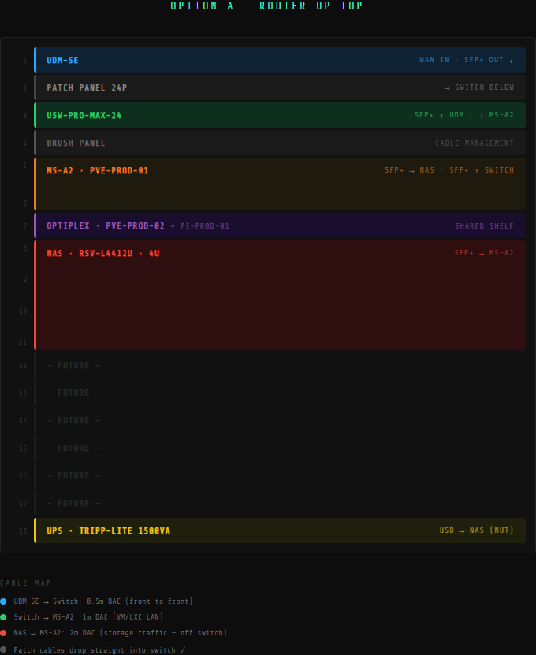

# Rack Layout

**Last Updated:** 2026-11-14  
**Rack:** StarTech 4POSTRACK18U (18U open-frame)  
**Status:** Built — three-node Proxmox architecture installed

---

## Unit Layout

The November 14, 2026 hardware maintenance established the current rack placement of the replacement Dell and Lenovo Proxmox nodes.

The original Dell OptiPlex 3070 Micro was retired and removed from U7.

The Lenovo ThinkCentre M90q Tiny (`pve-prod-03`) now occupies U7, sharing the rack shelf with the existing Raspberry Pi 4B (`pi-prod-01`).

The replacement Dell OptiPlex 5000 SFF (`pve-prod-02`) occupies a rack shelf at U17, immediately above the Tripp-Lite UPS at U18.

**Diagram note:** The existing rack diagram predates these changes and may still depict the original OptiPlex 3070. The updated text layout below is authoritative until the image is revised.



### Current Rack Layout

```text
U1  │ UniFi UDM-SE                 │ Router / Firewall
U2  │ UniFi UP-PATCH-24            │ Patch Panel (keystone)
U3  │ UniFi USW-Pro-Max-24         │ Core Switch
U4  │ Brush Panel                  │ Cable management
U5  │ Minisforum MS-A2             │ pve-prod-01 (2U custom bracket)
U6  │ Minisforum MS-A2             │ ↑ continued
U7  │ Lenovo M90q + Raspberry Pi   │ pve-prod-03 + pi-prod-01 (shared shelf)
U8  │ Rosewill RSV-L4412U          │ nas-prod-01 (4U)
U9  │ Rosewill RSV-L4412U          │ ↑ continued
U10 │ Rosewill RSV-L4412U          │ ↑ continued
U11 │ Rosewill RSV-L4412U          │ ↑ continued
U12 │ [Empty]                      │ Last documented
U13 │ [Empty]                      │ Last documented
U14 │ [Empty]                      │ Last documented
U15 │ [Empty]                      │ Last documented
U16 │ [Empty]                      │ Last documented
U17 │ Dell OptiPlex 5000 SFF      │ pve-prod-02 (rack shelf)
U18 │ Tripp-Lite SMART1500LCDXL    │ UPS (bottom)
```

### Physical Placement Changes — November 14, 2026

| Device | Previous Position | Current Position | Status |
|---|---|---|---|
| pve-prod-01 — Minisforum MS-A2 | U5–U6 | U5–U6 | Unchanged |
| Original pve-prod-02 — OptiPlex 3070 Micro | U7 | Retired / removed | Confirmed hardware replacement |
| pve-prod-03 — Lenovo M90q Tiny | Not previously installed | U7 | Operator-confirmed |
| pi-prod-01 — Raspberry Pi 4B | U7, shared shelf with original Dell | U7, shared shelf with Lenovo | Operator-confirmed |
| Replacement pve-prod-02 — OptiPlex 5000 SFF | Not previously installed | U17 | Operator-confirmed |
| nas-prod-01 — Rosewill RSV-L4412U | U8–U11 | U8–U11 | Unchanged |
| Tripp-Lite UPS | U18 | U18 | Unchanged |

### U7 Shared Shelf

The U7 rack shelf contains two independent devices:

| Device | Hardware | IP | Role |
|---|---|---|---|
| pve-prod-03 | Lenovo ThinkCentre M90q Tiny | 192.168.10.13 | Third Proxmox voting node; hosts secondary AdGuard and Authentik |
| pi-prod-01 | Raspberry Pi 4B | 192.168.10.20 | Monitoring host; former Proxmox QDevice |

**Physical arrangement:** Both devices share the U7 shelf.

**Networking:**

- Lenovo: USW-Pro-Max-24 port 16, operator-confirmed.
- Raspberry Pi: USW-Pro-Max-24 port 17 via PP15, last documented connection.

The Raspberry Pi's former QDevice function was removed before the three-node cluster was established. It no longer participates in Proxmox quorum.

### Physical Maintenance

Both replacement Proxmox nodes underwent physical maintenance on November 14, 2026.

- Systems were gracefully shut down.
- Chassis were cleaned.
- Hardware was reassembled.
- Nodes were installed on their rack shelves.
- Nodes were powered back on.
- Proxmox cluster membership and quorum were verified.
- ZFS storage health was checked.
- NUT monitoring was checked after maintenance.
- Both nodes returned to service successfully.

The three-node Proxmox cluster remained healthy and quorate.

---

## Non-Rack Devices

| Device | Location | IP | Notes |
|---|---|---|---|
| U6-Pro AP | Wall/ceiling mount | 192.168.10.200 | PoE via UDM-SE port 7. Management network is UniFi default VLAN 1, subnet 192.168.10.0/24. |

`pi-prod-01` is not classified as a non-rack device because it is installed on the U7 shelf alongside `pve-prod-03`.

---

## DAC Cable Map

| Cable | Length | From | To | Purpose |
|---|---|---|---|---|
| 10Gtek DAC | 0.5M | UDM-SE SFP+ | Switch SFP+ Port 1 (physical port 25) | 10GbE uplink between router and switch |
| Cable Matters DAC | 2M | nas-prod-01 X710 Port 1 | pve-prod-01 SFP+ Port 1 | Storage traffic — dedicated point-to-point, off LAN switch |
| Cable Matters DAC | 2M | nas-prod-01 X710 Port 2 | Switch SFP+ Port 2 (physical port 26) | NAS data/NFS interface to switch, Services VLAN 30 |

**Notes:**

- The MS-A2 connects to the switch via its **2.5GbE RJ45** interface, not an SFP+ switch uplink.
- The documented private storage link uses MS-A2 SFP+ Port 1 and NAS X710 Port 1.
- MS-A2 SFP+ Port 2 is not part of the documented active storage connection.
- The 2M DAC for NAS ↔ MS-A2 accounts for RSV-L4412U sliding rail extension slack (~1.5M actual path + margin).
- Storage traffic over the point-to-point DAC is intentionally kept off the LAN switch.
- The USW-Pro-Max-24 exposes SFP+ interfaces as physical ports **25 and 26** in the live UniFi interface.
- Both SFP+ ports reported link `UP` at 10 Gbps during the November 14 read-only UniFi inspection.
- DAC routes are preserved from the existing cabling documentation; cable identity was not independently inspected during this review.

---

## RJ45 Uplinks to Switch

The following table combines the existing cable documentation with the newly confirmed Proxmox node connections.

| Device | Interface | Link Speed | Switch Port | VLAN Profile |
|---|---|---|---|---|
| pve-prod-03 (Lenovo M90q) | 1GbE RJ45 | 1GbE | **SW Port 16** | VLAN-aware Proxmox uplink; live UniFi port profile not independently retrieved |
| pi-prod-01 (Raspberry Pi) | 1GbE RJ45 | 1GbE | SW Port 17 (via PP15), last documented | Historical Trunk - All VLANs profile; current port profile not reverified |
| pve-prod-02 (Dell OptiPlex 5000) | 1GbE RJ45 | 1GbE | **SW Port 19** (previously via PP17) | Trunk - All VLANs, last documented |
| nas-prod-01 onboard (TUF Z690) | 2.5GbE RJ45 | 2.5GbE | SW Port 20 (via PP18) | Mgmt - Only |
| pve-prod-01 (MS-A2) | 2.5GbE RJ45 | 2.5GbE | SW Port 21 (via PP19) | Trunk - All VLANs |

**November 14 live switch verification:**

| Switch Port | State | Negotiated Speed | Identified Connection |
|---|---|---|---|
| 16 | UP | 1 Gbps | pve-prod-03 — operator-confirmed |
| 17 | UP | 1 Gbps | pi-prod-01 — last documented mapping |
| 19 | UP | 1 Gbps | pve-prod-02 — operator-confirmed |
| 20 | UP | 2.5 Gbps | NAS management — existing documented mapping |
| 21 | UP | 2.5 Gbps | Primary Proxmox — existing documented mapping |
| 25 | UP | 10 Gbps | SFP+ uplink — existing documented mapping |
| 26 | UP | 10 Gbps | NAS SFP+ data link — existing documented mapping |

The live switch interface confirmed port state and speed.

The node-to-port identification for ports 16 and 19 was provided directly by the operator following physical installation.

**Port 16:** The previous documentation classified switch ports 2–16 as unused/disabled. Port 16 is now active and carries `pve-prod-03` traffic. That historical statement is superseded.

**Port 17:** The Raspberry Pi remains installed at U7. Its prior network mapping identifies switch port 17 via PP15. The physical cable path was not newly traced during this documentation update.

**Port 19:** The replacement Dell retained the existing `pve-prod-02` switch-port assignment. Its use of the original PP17 patch-panel path has not been separately confirmed after physical relocation.

**UDM-SE uplink correction:** The previous rack document contained an RJ45 uplink entry describing the UDM-SE as connected to switch port 26. The live switch identifies port 26 as an SFP+ interface, not RJ45.

The documented UDM-SE connection is the dedicated SFP+ DAC uplink. No additional RJ45 uplink is assumed.

### Management Network Terminology

The current UniFi Management network uses:

- Subnet: `192.168.10.0/24`
- Gateway: `192.168.10.1`
- Actual UniFi VLAN ID: **1**, default/untagged

Older documentation referred to the Management network as VLAN 10.

This was a documentation naming convention rather than the VLAN ID returned by live UniFi.

Existing physical switch-port profile names are retained where previously documented; no switch profile changes were made.

See `architecture/network/vlan-design.md`.

---

## UPS Outlet Map

**UPS:** Tripp-Lite SMART1500LCDXL  
**Capacity:** 1500VA / 900W  
**Rack position:** U18  
**USB monitoring:** Connected to nas-prod-01 for Network UPS Tools (NUT)

The following outlet table preserves the historical power connections.

**Important:** The rack now contains three Proxmox nodes, and the exact power-outlet assignments were not rechecked during the November 14 physical maintenance. The former "five devices connected, three spare" note was inconsistent with the six connections listed in the original table and is no longer considered current.

| Outlet | Previously Documented Device | Current Verification |
|---|---|---|
| 1 | UDM-SE | Physical connection not reverified |
| 2 | USW-Pro-Max-24 | Physical connection not reverified |
| 3 | pve-prod-01 (MS-A2) | Physical connection not reverified |
| 4 | Original pve-prod-02 (OptiPlex 3070) | Replacement Dell's outlet not confirmed |
| 5 | nas-prod-01 | Physical connection not reverified; USB data cable documented |
| 6 | pi-prod-01 | Device remains at U7; physical power connection not reverified |
| 7 | Previously spare | Current assignment unknown |
| 8 | Previously spare | Current assignment unknown |

### Proxmox Node Power Mapping

The replacement Dell at U17 is directly above the UPS.

The Lenovo at U7 shares its rack shelf with the Raspberry Pi.

Their current UPS power-outlet assignments have not been confirmed.

Do not assume that either host uses a particular UPS outlet until the physical connections are traced.

### NUT Configuration

NUT network clients are installed on all three Proxmox hosts:

| Host | IP | NUT Role |
|---|---|---|
| pve-prod-01 | 192.168.10.11 | Network UPS client |
| pve-prod-02 | 192.168.10.12 | Network UPS client |
| pve-prod-03 | 192.168.10.13 | Network UPS client |

The NUT server is hosted by `nas-prod-01` at `192.168.10.10`.

**November 14 verification for pve-prod-03:**

```text
systemctl is-enabled nut-monitor
enabled

systemctl is-active nut-monitor
active

upsc ups@192.168.10.10 ups.status
OL
```

These checks confirm service operation and UPS communication. They do not prove that every Proxmox host is connected to a battery-backed outlet.

### Shutdown Order

**Intended NUT-managed sequence:**

1. UPS transitions to battery operation.
2. NUT server monitors the UPS and initiates the configured shutdown process.
3. Proxmox nodes gracefully stop their VMs and LXCs.
4. All three Proxmox hosts shut down.
5. NAS shuts down after dependent workloads where the configured sequencing allows.

**Validation boundary:** NUT monitoring is operational, but a real UPS-triggered shutdown and end-to-end sequence have not been tested.

The original documentation's two-node shutdown sequence is superseded by the three-node architecture.

---

## Patch Panel → Switch Port Map

UniFi UP-PATCH-24 is installed at U2.

Short 0.5ft Monoprice SlimRun Cat6 patch cables connect patch-panel ports to the switch at U3.

The existing patch-panel inventory is preserved below, with updated current-host identification and verification notes.

| Patch Panel Port | Device | Cable Run | Switch Port | VLAN Profile |
|---|---|---|---|---|
| Not confirmed | pve-prod-03 (Lenovo M90q) | Physical path not documented | **SW Port 16** | Profile not independently reverified |
| PP15 | pi-prod-01 (Raspberry Pi) | Direct; historical mapping | SW Port 17 | Trunk - All VLANs, last documented |
| PP16 | Synology NAS | Direct | SW Port 18 | Trusted Access |
| PP17 | pve-prod-02 (Dell OptiPlex 5000) | Existing route; physical patch path not reverified after replacement | **SW Port 19** | Trunk - All VLANs, last documented |
| PP18 | nas-prod-01 onboard 2.5GbE | Direct | SW Port 20 | Mgmt - Only |
| PP19 | pve-prod-01 (MS-A2) | Direct | SW Port 21 | Trunk - All VLANs |
| PP20 | Gio PC (Desktop) | Wall run | SW Port 22 | Trusted Access |
| PP21 | Cove Alarm Panel | Wall run | SW Port 23 | IoT Access |
| PP22 | Eufy Homebase | Wall run | SW Port 24 | IoT Access |
| PP23 | U6-Pro AP | Wall run | UDM-SE Port 7 (PoE) | Trunk - All VLANs |
| PP24 | UDM-SE WAN | Wall run | — | — |
| SFP+ Port 1 | UDM-SE SFP+ | Direct DAC | SW physical port 25 | Uplink |
| SFP+ Port 2 | nas-prod-01 X710 Port 2 | Direct DAC | SW physical port 26 | Services VLAN 30 |

**Historical cabling caveat:** The source rack documentation was last updated March 10, 2026. Only the current Proxmox node connections and switch link states were specifically reconfirmed in November.

The remaining patch-panel mappings are retained from the existing inventory and should not be treated as newly verified.

**Wall runs (PP1–PP14):** Fill in as additional wall runs are terminated and labeled.

---

## Three-Node Proxmox Layout

As of November 14, 2026:

| Node | Hardware | Rack Position | Switch Port | Management IP |
|---|---|---|---|---|
| pve-prod-01 | Minisforum MS-A2 | U5–U6 | 21 | 192.168.10.11 |
| pve-prod-02 | Dell OptiPlex 5000 SFF | U17 | 19 | 192.168.10.12 |
| pve-prod-03 | Lenovo ThinkCentre M90q Tiny | U7, shared shelf with Raspberry Pi | 16 | 192.168.10.13 |

**Additional rack host:**

| Host | Hardware | Rack Position | Switch Port | Management IP |
|---|---|---|---|---|
| pi-prod-01 | Raspberry Pi 4B | U7, shared shelf with Lenovo M90q | 17 (last documented) | 192.168.10.20 |

The former Dell OptiPlex 3070 Micro was removed from the rack and retired.

The Raspberry Pi remained on its existing shelf at U7 while the Lenovo replaced the original Dell.

### Cluster Architecture

- Three Proxmox voting nodes.
- Two votes required for quorum.
- No external QDevice.
- No automatic Proxmox HA.
- Node-local ZFS storage on each Proxmox host.

The Raspberry Pi is not a cluster voting member.

### Workload Distribution

| Node | Current Workloads |
|---|---|
| pve-prod-01 | Primary AdGuard CT 100, Docker VM 101, AI Observer VM 107, stopped Dragonwilds VM 106 |
| pve-prod-02 | Immich VM 105 |
| pve-prod-03 | Secondary AdGuard CT 102, Authentik VM 104 |

Authentik was migrated from `pve-prod-01` to `pve-prod-03` on November 14.

The migration and subsequent PBS backup were successful.

The cluster remained online and quorate following hardware maintenance.

---

## Notes & Reminders

- Label both sides of each cable run: device → patch-panel port → switch port.
- Update the existing `rack-diagram.png` to show:
  - Lenovo M90q and Raspberry Pi sharing U7.
  - Replacement Dell OptiPlex 5000 SFF at U17.
  - Retired OptiPlex 3070 removed.
- Confirm whether node 03 uses a patch-panel connection or a direct patch cable to switch port 16.
- Reconfirm the PP15 cable path from the Raspberry Pi to switch port 17.
- Reconfirm the PP17 path for replacement node 02.
- Verify physical UPS outlet assignments for both new compute nodes.
- Reconfirm the Raspberry Pi's physical UPS power connection.
- Confirm all three Proxmox hosts receive battery-backed power if that is the intended design.
- Retain appropriate cable clearance around U17 and the UPS.
- Keep the shared U7 shelf organized so the Lenovo and Raspberry Pi have adequate airflow and accessible cabling.
- Test NAS sliding-rail extension and verify DAC slack before performing maintenance requiring the NAS to be pulled forward.
- Review historical switch-port descriptions before treating them as available or disabled.
- Switch port 16 is now active; do not treat the original "ports 2–16 unused" statement as current.
- Verify DAC links, switch uplinks, and Proxmox bridge health after future cabling changes.
- Do not modify production firewall, VLAN, switch-profile, or NUT settings merely to align them with historical rack documentation.

---

## Related Documentation

- `architecture/hardware/inventory.md` — Hardware specifications and inventory.
- `architecture/compute/pve-prod-01.md` — Primary Minisforum Proxmox node.
- `architecture/compute/pve-prod-02.md` — Replacement Dell Proxmox node.
- `architecture/compute/pve-prod-03.md` — Lenovo third Proxmox node.
- `architecture/compute/pi-prod-01.md` — Raspberry Pi monitoring and historical QDevice role.
- `architecture/network/ip-addresses.md` — Management and services addressing.
- `architecture/network/vlan-design.md` — VLAN IDs, firewall zones, and network segmentation.
- `architecture/network/firewall-rules.md` — Inter-network access policies.
- `architecture/storage/nas-prod-01.md` — NAS interfaces and UPS integration.
- `architecture/decisions-log.md` — Hardware and architecture decisions.
